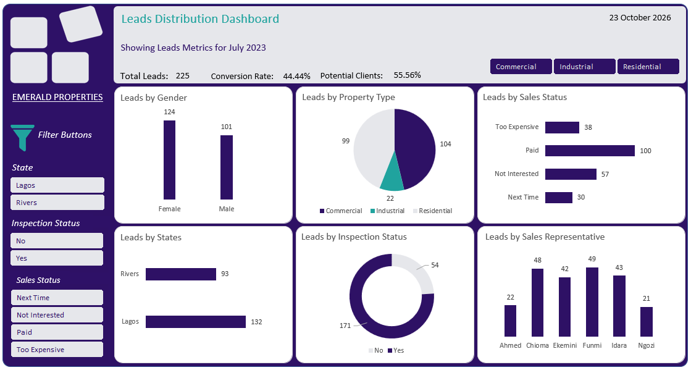

# Lead Distribution Analysis

## Project Overview:
This project analyses lead and sales performance data, to evaluate how leads are generated across various channel. The analysis explores lead allocation patterns, conversion trends, and channel performances to uncover insights that can support more effective sales operations and decision-making.

## Problem Statement:
Management currently lacks a clear, summarized view of lead-to-sale conversion performance for July 2023.
Specifically: 
* The overall conversion rate for the month is not clearly calculated or reported 
* Conversion performance across sales executives is unclear 
* It is difficult to see which customer segments (gender, inspection status) convert better 
* Conversion rates by branch and property type are not summarized 
* There is no visual comparison of factors associated with higher conversion 
without this clarity, management cannot: 
* Measure sales effectiveness 
* Compare conversion performance across teams and locations 
* Identify patterns linked to stronger conversion outcomes 

## Analysis Objectives:
The objective of this analysis is to calculate, visualize, and compare conversion rates for July 2023 and highlight patterns associated with higher conversion. This analysis aims to: 
* Calculate the overall lead-to-sale conversion rate 
* Compute conversion rates by sales executive 
* Compare conversion rates by gender 
* Analyze conversion rates by branch (state) 
* Evaluate conversion rates by property type 
* Compare conversion rates based on inspection status (Yes / No) 
* Identify which segments show relatively higher conversion performance

## Dataset Description:
The dataset contains lead generation records for the month of July, 2023. It consist of customer demographic information and sales-related data, including customer ID, gender, assigned sales representatives, sales status, state, property type and inspection status. The dataset was used to analyse lead generation and sales performance across different channels and regions.

## Methodology: 
* Data import and preparation.
* Data cleaning, transformation and manipulation using Power Query.
* Exploratory data analysis using Pivot Tables.
* Creation of calculated measures for key business metrics using DAX.
* Analysis of lead generation and sales performance across different channels.
* Dashboard development and data visualization.

## Key Business Insights
* A total of 225 leads were generated in July 2023.
* Female leads accounted for 124(55.1%) of the total lead, compared to 101(44.9%) male customers.
* Commercial property generated the highest volume of lead, indicating stronger customer interest in this segment. 
* Funmi and Chioma emerged as top-performing lead executives.
* 171 leads inspected the properties  while 54 did not proceed with inspection. 
* Lagos generated a higher lead volume than Rivers state, indicate stronger customer interest in that region.
* Out of the 225 leads generated, 100 converted into paying customers, giving a conversion rate of 44.44%.

## Business Value
* Built an interactive dashboard that provided management with a centralized view of lead KPIs and  conversion  performance.
* Identified top-performing and underperforming segments across property types, sales executives, branches and demographics.
* Supported data-driven decision-making through performance insights.
* Provided actionable insights into customer engagement and responses across property types and branches.
* 
## Tools Used
* Microsoft Excel
* Power Query
* Pivot Tables
* DAX
* Data visualization

# Dashboard Preview:
The dashboard presents key lead generation and conversion metrics from the July 2023 dataset, enabling
stakeholders to monitor performance, identify trends, and make data-driven decisions for future sales and marketing activities.

 
# Project File
* [Download Excel work's File](https://github.com/Yhubee-01/lead-distribution-analysis/blob/main/Emerald%20PP%20Ub.xlsx)
